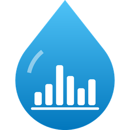

# Licznik wody Wrocław – integracja Home Assistant



Niestandardowa integracja Home Assistant (instalowana przez HACS), która pobiera **godzinowe zużycie wody**
z [eBOK MPWiK Wrocław](https://ebok.mpwik.wroc.pl) i importuje je do statystyk HA.
Dzięki temu dane da się pokazać w panelu **Energia → Zużycie wody**.

## Co dostajesz

- **Statystykę zewnętrzną** `licznik_wody_wroclaw:<podmiot>_<punkt>` z godzinowym zużyciem (m³). Każde zużycie trafia
  pod właściwą godzinę, mimo że eBOK publikuje dane z 2–3 dniowym opóźnieniem.
- Sensory:
  - *Stan wodomierza* (m³, `total_increasing`)
  - *Ostatni odczyt godzinowy* – data i godzina ostatniego odczytu (koniec godziny)
  - *Dzienne zużycie wody* – suma zużycia w dniu ostatniego odczytu, do jego godziny
    (doba liczona jak w eBOK: od 23:00 dnia poprzedniego)
  - *Godzinowe zużycie wody* – zużycie w godzinie ostatniego odczytu

## Ważne: logowanie

Formularz logowania eBOK jest chroniony przez **Google reCAPTCHA**, więc integracja nie loguje się
loginem i hasłem. Używa sesji, którą zakładasz w przeglądarce:

1. Zaloguj się na <https://ebok.mpwik.wroc.pl> i wejdź w *Zużycie wody*.
2. Otwórz narzędzia deweloperskie (F12) i przejdź do karty **Sieć / Network**.
3. Kliknij dowolne zapytanie do `frontend-api/...`, a w *Request Headers* skopiuj **całą** wartość nagłówka `Cookie`.
   Muszą się w niej znaleźć co najmniej `JSESSIONID` i `SERVERG1`.
4. Wklej ją podczas konfiguracji integracji.

Integracja co 5 minut odpytuje `/session/info`, żeby sesja nie wygasła. Sesja przepada m.in. przy dłuższej
przerwie (np. wyłączony HA) albo po wylogowaniu w przeglądarce. Wtedy HA pokaże powiadomienie o ponownym
uwierzytelnieniu i wystarczy wkleić nowe ciasteczko.
> Nie klikaj „Wyloguj” w przeglądarce, z której skopiowałeś ciasteczko, bo to zakończy także sesję integracji.
> Najlepiej po skopiowaniu po prostu zamknij kartę.

## Instalacja (HACS)

1. HACS → menu ⋮ → *Custom repositories* → dodaj adres tego repozytorium, kategoria **Integration**.
2. Zainstaluj „Licznik wody Wrocław” i zrestartuj Home Assistant.
3. *Ustawienia → Urządzenia i usługi → Dodaj integrację → Licznik wody Wrocław*.
4. Podaj **kod podmiotu** (liczba z parametru `?p=` w adresie eBOK), nagłówek `Cookie` oraz liczbę dni historii do pobrania.
5. Wybierz punkt sieci (wodomierz).
6. *Ustawienia → Panele → Energia → Zużycie wody → Dodaj źródło wody* i wybierz statystykę **Licznik wody …**.

Instalacja ręczna: skopiuj katalog `custom_components/licznik_wody_wroclaw` do `config/custom_components/`.

## Samodzielny skrypt (bez Home Assistant)

```bash
pip install aiohttp
```

```bash
MPWIK_COOKIE='JSESSIONID=...; SERVERG1=...' python3 tools/mpwik_fetch.py --podmiot 380281 --od 2026-10-01 --do 2026-10-15 -o zuzycie.csv
```

## Ikona

Ikona leży w `custom_components/licznik_wody_wroclaw/brand/` (nowsze wersje HA wczytują ją lokalnie; sprawdzone na 2026.10).
Żeby ją wygenerować ponownie: `pip install pillow && python3 tools/make_icon.py`.

## Historia zmian

- **0.4.0** – identyfikator integracji zmieniony na `licznik_wody_wroclaw` (zmiana łamiąca zgodność):
  po aktualizacji usuń starą integrację, dodaj ją od nowa i wybierz nową statystykę w panelu Energia.
- **0.3.0** – nazwa „Licznik wody Wrocław”; „Ostatni odczyt godzinowy” pokazuje datę i godzinę;
  nowe encje „Dzienne zużycie wody” i „Godzinowe zużycie wody” (zastępują dwie poprzednie encje zużycia).
- **0.2.0** – ikona integracji, producent urządzenia „ML”; zużycie dobowe liczone z danych godzinowych
  (ostatnia pełna doba 23:00–23:00, wcześniej bywało 0); „Ostatni odczyt godzinowy” pokazuje datę ostatniego dnia z danymi.
- **0.1.0** – pierwsza wersja.

## Użyte API eBOK

| Endpoint | Opis |
|---|---|
| `GET /frontend-api/v1/session/info` | stan sesji (`user_login` obecny = zalogowany) |
| `GET /frontend-api/v1/podmioty/{p}/punkty-sieci?status=AKTYWNE` | punkty sieci |
| `GET .../punkty-sieci/{punkt}/odczyty/godzinowe?dataOd=…&dataDo=…` | odczyty godzinowe, **maks. 1 doba na zapytanie** |
| `GET .../punkty-sieci/{punkt}/odczyty/dobowe?dataOd=…&dataDo=…` | odczyty dobowe |

Numer punktu `0670/5550` trafia do URL jako `0670-5550`. Czasy są lokalne (Europe/Warsaw) i oznaczają koniec godziny.

Projekt nieoficjalny, niezwiązany z MPWiK S.A. API może się zmienić bez uprzedzenia.
